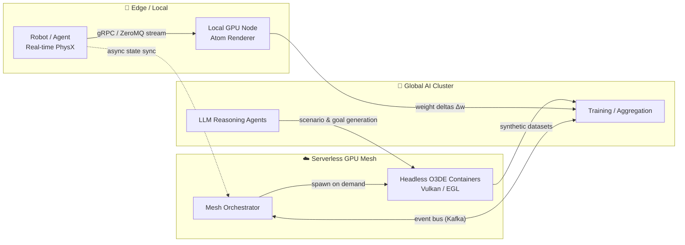

<div align="center">

# 🌐 Edge-Cloud Continuum


<p align="center">
  <a href="https://kallymeire.github.io/Edge-Cloud-Continuum-com-Serverless-Distributed-GPU-Mesh-Federated-Swarms/Docs/edge-cloud-demo/">
    
  </a>
</p>

<p align="center">
  
</p>

### Serverless Distributed GPU Mesh & Federated Swarms for Autonomous Systems

**An Open 3D Engine (O3DE) framework for physics-accurate simulation, domain-randomized synthetic data and LLM-driven agents — split across edge and cloud.**

[](LICENSE)
[](https://o3de.org/)
[]()
[]()
[]()
[]()

[Overview](#-overview) · [Architecture](#-architecture) · [Features](#-key-features) · [Quick Start](#-quick-start) · [Domain Randomization](#-domain-randomization-engine) · [Roadmap](#-roadmap) · [Tech Stack](#-tech-stack)

</div>

---

## 🎯 Overview

Training perception and control models for robots and autonomous vehicles needs **three things at once**: deterministic real-time physics, photorealistic rendering, and large amounts of varied data. No single machine does all three well.

**Edge-Cloud Continuum** splits the workload by what each tier does best:

| Tier | Responsibility | Why here |
| :--- | :--- | :--- |
| 🤖 **Edge** | PhysX stepping, collision, reflex loops | Latency-critical, must be deterministic |
| ☁️ **Serverless GPU mesh** | Headless Atom/Vulkan rendering, dataset generation | Bursty, elastic, pay only while rendering |
| 🧠 **Global AI cluster** | Training, LLM reasoning, weight aggregation | Compute-heavy, tolerant of latency |

The simulation runs inside **O3DE** through a native **C++17 Gem**, and is automated end-to-end by a **Python pipeline**.

---

## 🏛 Architecture



### Data flow in one paragraph
The edge node runs physics and control locally. Heavy rendering jobs are queued to the orchestrator, which starts containerized headless O3DE instances, runs the randomized scenarios, and tears them down. Simulation workers share **only compressed weight deltas (Δw)**, never raw data, so learning can be federated.

---

## ✨ Key Features

### 🧩 Native O3DE Gem (C++17)
- Custom **Gem** with a component-based design, registered through the standard O3DE project flow
- **EBus** interface (`CognitiveAgentBus`) for decoupled communication between agent logic and engine systems
- Hooks into the **Atom Renderer** frame pipeline for capturing frames
- Low-overhead streaming of frames and state to external processes over gRPC / IPC

### 🎲 Domain Randomization Engine
- Perturbs **PhysX** parameters (mass, friction, restitution) per episode
- Perturbs **Atom** environment (fog density, sun azimuth, PBR roughness) and camera pose per frame
- Purpose: reduce overfitting to a single simulated look, improve sim-to-real transfer

### 🤖 LLM Agent Bridge
- Python bridge connecting an LLM reasoning loop to in-engine agents
- The LLM proposes scenarios and goals; the engine validates and executes them

### 🐳 Headless, Containerized Execution
- `Dockerfile.o3de-headless` with Vulkan/EGL for GPU rendering without a display
- Designed for serverless GPU platforms: start on demand, shut down when idle

### 🌐 Federated Swarm Learning
- Parallel simulation instances sync via compressed weight deltas over an event stream
- Keeps raw data local and reduces bandwidth

---

## 📂 Repository Structure

```text
Edge-Cloud-Continuum-Serverless-GPU-Mesh/
├── Gem/                                  # Native C++ O3DE extension
│   └── Code/
│       ├── Include/
│       │   └── CognitiveAgentBus.h       # EBus interface
│       └── Source/
│           ├── CognitiveAgentComponent.h
│           └── CognitiveAgentComponent.cpp   # Core engine logic
├── Pipeline/                             # Python automation & AI integration
│   ├── core/
│   │   ├── domain_randomizer.py          # PhysX & Atom perturbation
│   │   └── llm_agent_bridge.py           # LLM ↔ engine bridge
│   └── run_simulation.py                 # Headless runner CLI
├── Infrastructure/
│   └── docker/
│       └── Dockerfile.o3de-headless      # Headless Vulkan/EGL image
├── Docs/
│   └── ARCHITECTURE.md                   # Memory & dataflow specs
├── .gitignore
└── README.md
```

---

## ⚡ Quick Start

### Prerequisites
- O3DE **23.10+**, Visual Studio 2022 (Windows) with the C++ workload
- CMake 3.24+
- Python 3.10+
- NVIDIA GPU with Vulkan support (for local rendering)
- Docker (for headless runs)

### 1. Register and build the Gem

```bash
# Register the Gem with your O3DE installation
o3de.bat register --gem-path ./Gem

# Configure and build in Release mode
cmake -B build/ -S . -G "Visual Studio 17 2022" -DCMAKE_BUILD_TYPE=Release
cmake --build build/ --target CognitiveAgentGem.Packages --config Release
```

### 2. Run the headless simulation and data pipeline

```bash
python Pipeline/run_simulation.py \
  --config Pipeline/config.json \
  --workers 8 \
  --output-dir ./Datasets/synthetic_output \
  --enable-llm-agents
```

### 3. Build the headless container (optional)

```bash
docker build -f Infrastructure/docker/Dockerfile.o3de-headless -t o3de-headless .
```

---

## 🎲 Domain Randomization Engine

| Category | Parameters | Applied |
| :--- | :--- | :--- |
| **Physics (PhysX)** | mass, friction, restitution | per episode |
| **Environment (Atom)** | fog density, solar azimuth, PBR roughness | per frame |
| **Camera** | position, orientation, perspective | per frame |

---

## 🆚 Why This Architecture?

| Approach | Cost model | Scaling | Failure handling |
| :--- | :--- | :--- | :--- |
| Monolithic VM | Billed continuously | Limited to one machine | Manual |
| Standard Kubernetes | Persistent cluster sizing | High, bounded by node pools | Automatic pod restarts |
| **Serverless GPU mesh (this project)** | Pay per execution | Elastic, scales with queue | Retry/respawn of stateless workers |

---

## 🗺 Roadmap

- [x] Native Gem with EBus component skeleton
- [x] Domain randomization module (PhysX + Atom parameters)
- [x] Headless container specification
- [ ] Benchmarks: frame throughput and cold-start time (measured, published)
- [x] Animated architecture diagram and interactive demo
- [ ] Orchestrator reference implementation
- [x] Federated aggregation prototype
- [x] CI pipeline for Gem build and Python tests

> Contributions and issues are welcome.
---

## 🛠 Tech Stack

| Area | Technologies |
| :--- | :--- |
| **Engine** | O3DE, Atom Renderer, PhysX, EBus, Asset Processor |
| **Languages** | C++17, Python 3.10+ |
| **Communication** | gRPC, ZeroMQ, Kafka |
| **Infrastructure** | Docker, Vulkan/EGL, serverless GPU platforms |
| **AI** | LLM agents, federated learning concepts |

---

## 📚 Documentation

- [`Docs/ARCHITECTURE.md`](Docs/ARCHITECTURE.md) — memory layout and dataflow specs

## 📜 License

Distributed under the MIT License. See [`LICENSE`](LICENSE).

<div align="center">

**Built by [Kallymeire Coelho](https://github.com/kallymeire)** · Software Engineering · Simulation · AI Infrastructure

</div>