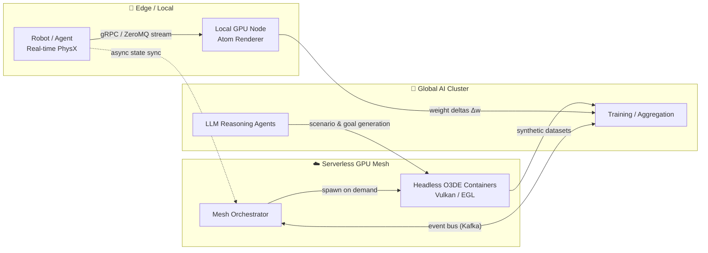

<div align="center">

# 🌐 Edge-Cloud Continuum


<p align="center">
  <a href="https://kallymeire.github.io/Edge-Cloud-Continuum-com-Serverless-Distributed-GPU-Mesh-Federated-Swarms/Docs/edge-cloud-demo/">
    
  </a>
</p>

<p align="center">
  
</p>

[](https://github.com/kallymeire/Edge-Cloud-Continuum-com-Serverless-Distributed-GPU-Mesh-Federated-Swarms/actions/workflows/ci.yml)

### Serverless Distributed GPU Mesh & Federated Swarms for Autonomous Systems

**An Open 3D Engine (O3DE) project for domain-randomized simulation scenarios, with a federated aggregation prototype and an LLM agent bridge (tested against a mocked endpoint). C++ Gem and cloud pieces in progress.**

[](LICENSE)
[](https://o3de.org/)
[]()
[]()
[]()
[]()

[Overview](#-overview) · [Architecture](#-architecture) · [Features](#-key-features) · [Quick Start](#-quick-start) · [Domain Randomization](#-domain-randomization-engine) · [Roadmap](#-roadmap) · [Tech Stack](#-tech-stack)

</div>

---

## 🎯 Overview

Training perception and control models for robots and autonomous vehicles needs **three things at once**: deterministic real-time physics, photorealistic rendering, and large amounts of varied data. No single machine does all three well.

**Edge-Cloud Continuum** splits the workload by what each tier does best:

| Tier | Responsibility | Why here |
| :--- | :--- | :--- |
| 🤖 **Edge** | PhysX stepping, collision, reflex loops | Latency-critical, must be deterministic |
| ☁️ **Serverless GPU mesh** | Headless Atom/Vulkan rendering, dataset generation | Bursty, elastic, pay only while rendering |
| 🧠 **Global AI cluster** | Training, LLM reasoning, weight aggregation | Compute-heavy, tolerant of latency |

The simulation runs inside **O3DE** through a native **C++17 Gem**, and is automated end-to-end by a **Python pipeline**.

---

## 🏛 Architecture



### Data flow in one paragraph
The edge node runs physics and control locally. Heavy rendering jobs are queued to the orchestrator, which starts containerized headless O3DE instances, runs the randomized scenarios, and tears them down. Simulation workers share **only compressed weight deltas (Δw)**, never raw data, so learning can be federated.

---

## ✨ Key Features

### 🧩 Native O3DE Gem (C++17)
- Custom **Gem** with a component-based design, registered through the standard O3DE project flow
- **EBus** interface (`CognitiveAgentBus`) for decoupled communication between agent logic and engine systems
- Hooks into the **Atom Renderer** frame pipeline for capturing frames
- Low-overhead streaming of frames and state to external processes over gRPC / IPC

### 🎲 Domain Randomization Engine
- Perturbs **PhysX** parameters (mass, friction, restitution) per episode
- Perturbs **Atom** environment (fog density, sun azimuth, PBR roughness) and camera pose per frame
- Purpose: reduce overfitting to a single simulated look, improve sim-to-real transfer

## 📈 Benchmarks

### Scenario generation

Run with `python Pipeline/benchmark.py`: 2000 episodes, 5 frames per episode, JSON written to disk.

**Machine:** Intel64 (Family 6 Model 42), 4 logical CPUs, Python 3.10.11

| Workers | Time (s) | Episodes/s | Frames/s |
| ---: | ---: | ---: | ---: |
| 1 | 25.14 | 80 | 398 |
| 2 | 11.77 | 170 | 850 |
| 4 | 10.57 | 189 | 946 |
| 8 | 11.76 | 170 | 850 |

Throughput scales up to the number of logical CPUs and does not improve beyond it. Each configuration was run once, so small differences are within noise. This measures CPU-side scenario generation only, with no rendering. Results depend on the machine.

### Federated aggregation: traffic vs. accuracy

Run with `python Pipeline/benchmark_federated.py`. Setup: 8 workers, 30 rounds, 64 features, 500 samples per worker, averaged over 5 seeds (mean ± standard deviation). Each worker sends a top-k sparsified, int8-quantized delta-w with error feedback.

| Top-k | Federated acc | Gap vs centralized | Sent (KiB) | vs dense float32 | vs raw data |
| ---: | ---: | ---: | ---: | ---: | ---: |
| 1 | 0.849 ± 0.024 | +0.000 ± 0.003 | 46.6 | 1.3x | 21.5x |
| 0.5 | 0.850 ± 0.024 | +0.000 ± 0.004 | 24.1 | 2.5x | 41.6x |
| 0.25 | 0.850 ± 0.024 | -0.000 ± 0.004 | 12.9 | 4.7x | 77.9x |
| 0.1 | 0.849 ± 0.025 | +0.001 ± 0.002 | 5.9 | 10.4x | 171.3x |
| 0.05 | 0.844 ± 0.026 | +0.006 ± 0.004 | 3.8 | 16.2x | 267.7x |
| 0.02 | 0.841 ± 0.027 | +0.009 ± 0.009 | 2.3 | 26.0x | 428.3x |

- Down to top-k = 0.1, federated accuracy matches centralized training within noise while sending about 10x less than dense float32 deltas.
- At 0.05 and 0.02 a small accuracy gap appears (about 0.6 and 0.9 points).
- "Gap" is centralized accuracy minus federated accuracy, so positive means federated is slightly worse.
- **Limits:** this is a synthetic logistic-regression setup, so it demonstrates the communication pattern, not a real robotics workload. The saving versus raw data depends on model size relative to dataset size and should not be generalized. With top-k = 1 the 1.3x comes from int8 quantization alone.

---

### 🤖 LLM Agent Bridge
- Python bridge connecting an LLM reasoning loop to in-engine agents
- The LLM proposes scenarios and goals; the engine validates and executes them

### 🐳 Headless, Containerized Execution
- `Dockerfile.o3de-headless` with Vulkan/EGL for GPU rendering without a display
- Designed for serverless GPU platforms: start on demand, shut down when idle

### 🌐 Federated Swarm Learning
- Parallel simulation instances sync via compressed weight deltas over an event stream
- Keeps raw data local and reduces bandwidth

---

## 📂 Repository Structure

```text
Edge-Cloud-Continuum-Serverless-GPU-Mesh/
├── Gem/                                  # Native C++ O3DE extension
│   └── Code/
│       ├── Include/
│       │   └── CognitiveAgentBus.h       # EBus interface
│       └── Source/
│           ├── CognitiveAgentComponent.h
│           └── CognitiveAgentComponent.cpp   # Core engine logic
├── Pipeline/                             # Python automation & AI integration
│   ├── core/
│   │   ├── domain_randomizer.py          # PhysX & Atom perturbation
│   │   └── llm_agent_bridge.py           # LLM ↔ engine bridge
│   └── run_simulation.py                 # Headless runner CLI
├── Infrastructure/
│   └── docker/
│       └── Dockerfile.o3de-headless      # Headless Vulkan/EGL image
├── Docs/
│   └── ARCHITECTURE.md                   # Memory & dataflow specs
├── .gitignore
└── README.md
```

---

## ⚡ Quick Start

### Prerequisites
- Python 3.10+
- Docker (optional, for the container run)
- O3DE 23.10+, Visual Studio 2022 and CMake 3.24+ are only needed for the Gem, which is not buildable yet

### 1. Run the tests

```bash
pip install -r Pipeline/requirements.txt
python -m pytest Pipeline/tests -v
```

### 2. Generate randomized scenarios

```bash
python Pipeline/run_simulation.py \
  --config Pipeline/config.json \
  --output-dir ./Datasets/synthetic_output \
  --workers 4 \
  --seed 7
```

Output: one `episode_XXXXX.json` file per episode in `Datasets/synthetic_output/`.

### 3. Run with Docker

```bash
docker build -f Infrastructure/docker/Dockerfile.pipeline -t edge-cloud-pipeline .
docker run --rm -v "$PWD/out:/out" edge-cloud-pipeline
```

On Windows PowerShell, use `"${PWD}/out:/out"` for the volume.

### 4. O3DE Gem

Not runnable yet. The component sources are in `Gem/Code`, but the build files (`gem.json`, `CMakeLists.txt`) are still missing. Build instructions will be added once it compiles in O3DE.

---

### 2. Run the headless simulation and data pipeline

```bash
python Pipeline/run_simulation.py \
  --config Pipeline/config.json \
  --workers 8 \
  --output-dir ./Datasets/synthetic_output \
  --enable-llm-agents
```

### 3. Build the headless container (optional)

```bash
docker build -f Infrastructure/docker/Dockerfile.o3de-headless -t o3de-headless .
```

---

## 🎲 Domain Randomization Engine

| Category | Parameters | Applied |
| :--- | :--- | :--- |
| **Physics (PhysX)** | mass, friction, restitution | per episode |
| **Environment (Atom)** | fog density, solar azimuth, PBR roughness | per frame |
| **Camera** | position, orientation, perspective | per frame |

---

## 🆚 Why This Architecture?

| Approach | Cost model | Scaling | Failure handling |
| :--- | :--- | :--- | :--- |
| Monolithic VM | Billed continuously | Limited to one machine | Manual |
| Standard Kubernetes | Persistent cluster sizing | High, bounded by node pools | Automatic pod restarts |
| **Serverless GPU mesh (target design)** | Pay per execution | Elastic, scales with queue | Retry/respawn of stateless workers (design goal, not implemented yet) |
---

## 🗺 Roadmap

## 🗺 Roadmap

**Done and verified**
- [x] Seeded domain randomizer with configurable ranges (physics, environment, camera)
- [x] Parallel scenario generator CLI
- [x] Benchmark of scenario generation throughput (episodes/s and frames/s by worker count)
- [x] Federated aggregation prototype (top-k compression with error feedback, 11 tests)
- [x] Benchmark of federated traffic savings (top-k sweep, 5 seeds)
- [x] LLM agent bridge with validated output and rule-based fallback (5 tests, mocked endpoint)
- [x] CI running the Python test suite (16 tests)
- [x] Dockerfile for the scenario generator (`docker build` and `docker run` verified; no GPU, no O3DE)
- [x] Architecture diagram

**In progress / planned**
- [ ] Gem build files (`gem.json`, `CMakeLists.txt`) and a component that loads in the O3DE Editor
- [ ] Apply generated scenarios to PhysX bodies and Atom settings inside O3DE
- [ ] Validate the bridge against a real local model (Ollama)
- [ ] Headless O3DE container with Vulkan/EGL (draft Dockerfile, not validated)
- [ ] Orchestrator reference implementation

> Contributions and issues are welcome.

---

## 🛠 Tech Stack

| Area | Technologies |
| :--- | :--- |
| **Engine** | O3DE, Atom Renderer, PhysX, EBus, Asset Processor |
| **Languages** | C++17, Python 3.10+ |
| **Communication** | gRPC, ZeroMQ, Kafka |
| **Infrastructure** | Docker, Vulkan/EGL, serverless GPU platforms |
| **AI** | LLM agents, federated learning concepts |

---

## 📚 Documentation

- [`Docs/ARCHITECTURE.md`](Docs/ARCHITECTURE.md) — memory layout and dataflow specs

## 📜 License

Distributed under the MIT License. See [`LICENSE`](LICENSE).

<div align="center">

**Built by [Kallymeire Coelho](https://github.com/kallymeire)** · Software Engineering · Simulation · AI Infrastructure

</div>